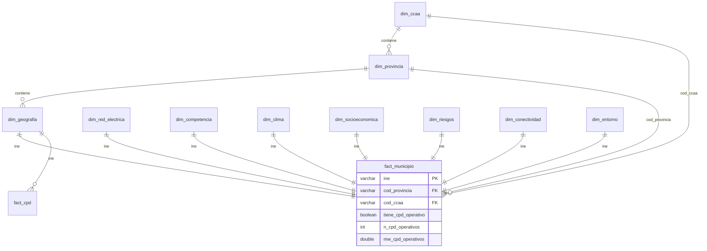

# Data Warehouse

**Motor:** DuckDB (fichero único `data/gold/cpd_warehouse.duckdb`, sin servidor).
**Modelo:** esquema en estrella. **Grano de los hechos:** un municipio, identificado por su código INE de 5 dígitos.
**Construcción:** `python -m src.warehouse.build` lee los Parquet de `data/silver` y la referencia CSV `data/reference/regulacion_ccaa.csv`, y crea el almacén y `features.parquet` en Gold. Definición de las tablas: [`src/warehouse/schema.sql`](../src/warehouse/schema.sql).

## 1. Cómo se genera

Desde la raíz del repo, después de la ingesta (`python -m src.ingest.run_all`):

```bash
# ETL (capa Silver): data/silver/*.parquet
python -m src.etl.ree_nudos
python -m src.etl.cpd_espana
python -m src.etl.variables_extra
python -m src.etl.socioeconomico
python -m src.etl.sismicidad
python -m src.etl.geografia
python -m src.etl.entorno

# Data Warehouse (capa gold)
python -m src.warehouse.build
```

El script construye el almacén en un fichero temporal y solo sustituye el `.duckdb` cuando pasan todas las comprobaciones (sección 4). Exporta la vista final a un Parquet temporal, valida filas, columnas y códigos INE y después reemplaza `features.parquet`. Si la construcción o validación falla, el almacén y el Parquet finales anteriores permanecen intactos.

Al migrar una instalación anterior, ejecuta `python -m src.data_migration --dry-run` y después `python -m src.data_migration`. Este movimiento seguro cambia `data/raw`, `data/processed` y `data/warehouse` a `data/bronze`, `data/silver` y `data/gold`; aborta sin modificar carpetas si ya existe un destino. Regenera los Silver Parquet ejecutando los comandos ETL de arriba.

## 2. Esquema



Las dimensiones temáticas tienen una fila por municipio (relación 1:1 con el hecho). Es una decisión de diseño: hay ~60 variables por municipio y agruparlas por tema hace el modelo más legible. La geografía es la única dimensión con jerarquía (municipio → provincia → CCAA).

## 3. Tablas

| Tabla | Filas | Grano | Contenido | Parquet de origen |
|---|---|---|---|---|
| `fact_municipio` | 8.135 | municipio | Claves de todas las dimensiones + **etiqueta del modelo** (`tiene_cpd_operativo`), nº y MW de CPD operativos | geografía, competencia |
| `dim_geografia` | 8.135 | municipio | Nombre, provincia, centroide (lat/lon) | `municipio_geografia.parquet` |
| `dim_provincia` | 52 | provincia | Nombre y CCAA | `municipio_geografia.parquet` |
| `dim_ccaa` | 19 | CCAA | Puntuación regulatoria 1-5 y notas | `regulacion_ccaa.csv` |
| `dim_red_electrica` | 8.135 | municipio | Nudo de REE más cercano, MW libres en 25/50 km, distancia a nudos de 50/100 MW | `municipio_capacidad_red.parquet` |
| `dim_competencia` | 8.135 | municipio | CPD operativos y en cartera en 50 km, hiperescala, distancia al CPD más cercano | `municipio_competencia_cpd.parquet` |
| `dim_clima` | 8.135 | municipio | Índice de aridez, días con temperatura media < 18 ºC | `municipio_variables_extra.parquet` |
| `dim_socioeconomica` | 8.135 | municipio | Población (2015 y 2025), crecimiento, renta 2024, paro (12 meses), valor tasado €/m² | `municipio_socioeconomico.parquet`, `municipio_variables_extra.parquet` |
| `dim_riesgos` | 8.135 | municipio | % inundable (100 y 500 años), terremotos en 50 km, magnitud máxima | `municipio_variables_extra.parquet`, `municipio_sismicidad.parquet` |
| `dim_conectividad` | 8.135 | municipio | Cables submarinos, universidades, bomberos | `municipio_variables_extra.parquet` |
| `dim_entorno` | 8.135 | municipio | Altitud y pendiente media, distancia a embalse (y nº en 30 km), a río principal, a suelo industrial (y nº en 10 km), a autopista, puerto y aeropuerto | `municipio_entorno.parquet` |
| `fact_cpd` | 278 | CPD | Cada CPD: operador, estado, MW, coordenadas, municipio | `cpd_espana.parquet` |
| `nudo_ree` | 937 | nudo de REE | Capacidad de acceso para demanda de cada nudo | `ree_nudos_capacidad.parquet` |
| `meta_carga` | 12 | tabla | Trazabilidad: fuente, filas y fecha de carga | — |
| `vw_features_municipio` (vista) | 8.135 | municipio | Todo unido en una tabla plana (66 columnas) para el modelo y el dashboard | exportada como `features.parquet` |

## 4. Comprobaciones de calidad

`build.py` no da la carga por buena si falla alguna:

- **No se pierde ningún municipio:** las 8 tablas por municipio y la vista final tienen exactamente los mismos municipios que la geografía (8.135).
- **Integridad referencial:** claves primarias y foráneas declaradas en `schema.sql`; DuckDB rechaza cualquier fila que no las cumpla.
- **Regulación:** las 19 CCAA tienen fila en `regulacion_ccaa.csv`.

Además informa de los valores vacíos de cada columna de la vista.

## 5. Ejemplos de consulta

```python
import duckdb
con = duckdb.connect("data/gold/cpd_warehouse.duckdb", read_only=True)

# Tabla para entrenar el modelo
df = con.execute("SELECT * FROM vw_features_municipio").df()

# CPD y MW operativos por comunidad
con.execute("""
    SELECT c.ccaa, sum(f.n_cpd_operativos) AS cpd, round(sum(f.mw_cpd_operativos)) AS mw
    FROM fact_municipio f JOIN dim_ccaa c USING (cod_ccaa)
    GROUP BY 1 ORDER BY cpd DESC
""").df()
```

## 6. Limitaciones conocidas

- **Regulación provisional:** las 19 puntuaciones de `regulacion_ccaa.csv` son provisionales hasta que el equipo las valide (columna `regulacion_provisional`).
- **Renta:** el INE no publica la mediana por unidad de consumo en los municipios pequeños (17,5 % vacíos) y no da renta para 83 municipios. La renta neta por persona cubre el 99 %.
- **Tasa de paro aproximada:** parados / población total. El SEPE no publica población activa por municipio. Los valores "<5" del SEPE se cuentan como 2,5.
- **Territorios compartidos:** OSM incluye 3 "comunidades" o "cotos" de tierras compartidas entre pueblos (INE 09711, 37701, 53053). No tienen población ni paro; se mantienen para no perder filas. El de código de provincia 53 se asigna a la provincia del municipio más cercano (León).
- **Sismicidad:** es actividad observada (EMSC, M ≥ 3 desde 1998), no la peligrosidad oficial de la norma NCSE-02. `mag_max_50km` vacío significa que no hubo terremotos en 50 km.
- **Ríos:** vienen de Natural Earth 1:10m y solo incluyen los ríos principales (66 tramos en España); en Canarias no hay, por lo que `dist_rio_principal_km` es muy grande allí. Los embalses (OSM) cubren mejor el agua disponible. Mejorable con la red hidrográfica del MITECO.
- **Topografía:** la pendiente se calcula con 4 alturas a ~1 km del centroide (EU-DEM 25 m / SRTM), no con el relieve completo del término municipal.
- **Distancias de entorno:** son en línea recta al centro del elemento de OSM, no por carretera.
- **Zonas inundables:** el SNCZI solo cartografía los tramos con riesgo significativo. Un 0 % significa "sin zona inundable cartografiada", no "riesgo nulo".
